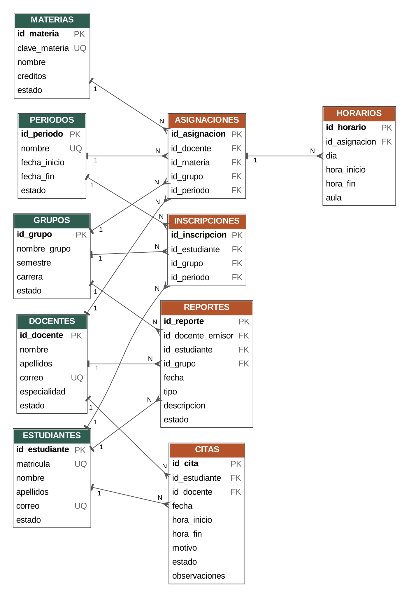

# ITIID Connect

Base de datos relacional en PostgreSQL, alojada en la nube (Supabase), para organizar la información académica de la carrera de ITIID: docentes, estudiantes, grupos, materias, periodos, horarios, citas de asesoría y reportes.

La idea principal: **un estudiante solo puede agendar una cita con un docente si el docente está libre.** La base de datos revisa el horario de clases y las citas que ya existen. Si hay un cruce, rechaza la cita y deshace todo con `ROLLBACK`.

> Proyecto escolar de la materia *Optativa I: Bases de Datos en la Nube*, 7.º cuatrimestre, Universidad Politécnica de Chiapas. Todos los docentes y la mayoría de los datos de prueba son ficticios.

## Qué incluye

| Tema | Dónde está |
|---|---|
| 10 tablas con PK, FK, `NOT NULL`, `UNIQUE` y `CHECK` | [`sql/01_esquema.sql`](sql/01_esquema.sql) |
| Datos de prueba | [`sql/02_datos.sql`](sql/02_datos.sql) |
| Índices | [`sql/03_indices.sql`](sql/03_indices.sql) |
| Función `registrar_cita` (transacción + validación de conflictos) y vistas | [`sql/04_registrar_cita.sql`](sql/04_registrar_cita.sql) |
| Roles, permisos y seguridad por fila (RLS) | [`sql/05_roles.sql`](sql/05_roles.sql) |
| Consultas con `JOIN`, `GROUP BY`, `HAVING`, `UNION` y `EXPLAIN` | [`pruebas/01_consultas.sql`](pruebas/01_consultas.sql) |
| Pruebas de restricciones (datos que deben fallar) | [`pruebas/02_restricciones.sql`](pruebas/02_restricciones.sql) |
| Transacciones: `COMMIT`, `ROLLBACK` y conflictos | [`pruebas/03_transacciones.sql`](pruebas/03_transacciones.sql) |
| Pruebas de permisos por rol | [`pruebas/04_permisos.sql`](pruebas/04_permisos.sql) |
| CRUD de citas en Python | [`app/citas.py`](app/citas.py) |
| Dos estudiantes reservando el mismo horario al mismo tiempo | [`app/prueba_concurrencia.py`](app/prueba_concurrencia.py) |

## Modelo de datos



- **Entidades base** (verde): `docentes`, `estudiantes`, `grupos`, `materias`, `periodos`.
- **Entidades con llaves foráneas** (naranja): `inscripciones`, `asignaciones`, `horarios`, `citas`, `reportes`.
- `inscripciones` resuelve la relación N:M entre estudiantes y grupos (por periodo).
- `asignaciones` une a un docente con una materia, un grupo y un periodo; `horarios` dice cuándo y dónde es esa clase.

Algunas reglas que pusimos con `CHECK` y `UNIQUE`:

- La matrícula son 6 dígitos y no se repite. El correo tampoco se repite.
- Una cita termina después de empezar y dura máximo una hora.
- Un estudiante solo puede estar en un grupo por periodo.
- Una materia no se asigna dos veces al mismo grupo en el mismo periodo.
- Un reporte siempre es sobre un estudiante o sobre un grupo.

## Cómo funciona `registrar_cita`

```
BEGIN
  1. ¿El estudiante existe y está activo?
  2. ¿El docente existe y está activo?  ->  se bloquea su fila (FOR UPDATE)
  3. ¿La fecha es válida (a partir de mañana y no domingo)?
  4. ¿El docente tiene clase a esa hora?
  5. ¿El docente ya tiene otra cita a esa hora?
  6. ¿El estudiante ya tiene otra cita a esa hora?
  7. Se inserta la cita
COMMIT     (si algo falla en 1-6: ERROR y ROLLBACK, no se guarda nada)
```

**Caso de complejidad:** si dos estudiantes piden el mismo horario al mismo tiempo, el `FOR UPDATE` hace que el segundo espere a que el primero termine. Cuando el segundo vuelve a revisar, el horario ya está ocupado y su cita se rechaza. Así se cumple ACID: o se guarda todo o nada (atomicidad), nunca quedan dos citas cruzadas (consistencia), una operación no pisa a la otra (aislamiento) y lo confirmado se queda guardado (durabilidad).

```text
$ python app/prueba_concurrencia.py
[243691] REGISTRADA cita 9  (2.0 s)
[243702] RECHAZADA: Conflicto: el docente ya tiene una cita en ese horario  (2.0 s)
```

## Roles y permisos

| Rol | Usuario de ejemplo | Qué puede hacer |
|---|---|---|
| `rol_admin` | `admin_itiid` | Todo sobre los datos del esquema |
| `rol_docente` | `doc_lgomez` | Consultar; ver y atender **solo sus** citas (cambiar estado y observaciones); levantar reportes |
| `rol_estudiante` | `est_243790` | Ver docentes, materias y horarios; ver **solo sus** citas; agendar únicamente con `registrar_cita` y a su nombre |
| `rol_consulta` | `consulta_itiid` | Solo lectura |

"Solo sus citas" se logra con **Row Level Security** en la tabla `citas`. Además, todo vive en el esquema `itiid` y no en `public`, porque en Supabase lo que está en `public` queda expuesto por su API web.

## Cómo correrlo

### Opción A: en la nube con Supabase (plan Free)

1. Entra a [supabase.com](https://supabase.com), crea un proyecto **Free** y guarda la contraseña de la base de datos.
2. Abre **SQL Editor > New query** y ejecuta, en orden, `sql/01` → `sql/05`. Antes de ejecutar `05_roles.sql`, cambia `CAMBIAR_ESTA_CLAVE` por una contraseña tuya.
3. Ejecuta los archivos de `pruebas/`. En `02`, `03` y `04` selecciona **un bloque a la vez** y dale *Run*; los errores que dicen "Esperado" son la prueba.
4. Para conectarte desde tu computadora, usa **Connect > Session pooler**. Copia la cadena en un archivo `.env` (mira `.env.example`).
   - Para entrar con un usuario de la tabla anterior, el nombre va con la referencia del proyecto: `est_243790.TU_REFERENCIA`.

> Supabase pausa los proyectos Free que no se usan en una semana; se reactivan desde el panel.

### Opción B: local con Docker

```bash
docker compose up -d                                  # crea la base y ejecuta sql/01..05
docker exec -it itiid_postgres psql -U postgres -d itiid
```

### CRUD en Python

```bash
python -m venv .venv
.venv\Scripts\activate          # Windows  (en Linux/Mac: source .venv/bin/activate)
pip install -r requirements.txt
copy .env.example .env          # y pon tu DATABASE_URL
python app/citas.py
```

```text
ITIID Connect · conectado como postgres

  1. Ver citas
  2. Ver horarios de docentes
  3. Agendar cita
  4. Cambiar estado de una cita
  5. Eliminar cita
  0. Salir
```

Si entras con el usuario de un estudiante, el mismo programa solo te deja ver tus citas y agendar a tu nombre. Los permisos los decide la base de datos, no el programa.

## Lo que aprendimos

- Que una base de datos puede proteger sus propias reglas: un dato mal capturado se rechaza aunque venga de cualquier programa.
- Cuándo hace falta una transacción y por qué `FOR UPDATE` evita que dos personas "ganen" el mismo horario.
- Que los huecos en los `id` (por ejemplo, que después de la cita 6 siga la 10) son normales: un intento fallido también gasta un número de la secuencia.
- Que en la nube la seguridad se piensa desde el principio: esquema propio, roles mínimos y contraseñas fuera del repositorio.

## Equipo

- Carlos Andrés Mazariegos Laguna
- Heber Alexander Escobar Nuricumbo
- Axel Rodrigo Cuc López

Ingeniería en Tecnologías de la Información e Innovación Digital · UP Chiapas · 2026
